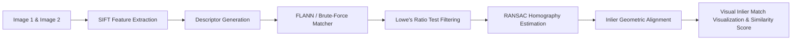

# Visual Feature Comparator

An interactive computer vision web application that performs fine-grained feature matching, geometric verification, and similarity analysis between image pairs using advanced keypoint descriptors.

---

## Algorithmic Workflow



1. **Scale-Invariant Feature Transform (SIFT)**: Detects scale- and rotation-invariant keypoints across multi-octave Difference-of-Gaussians (DoG) space.
2. **Fast Library for Approximate Nearest Neighbors (FLANN)**: Accelerated KD-tree nearest-neighbor descriptor matching.
3. **Lowe's Ratio Test**: Distinguishes valid matches from background noise ($d_1 / d_2 < 0.75$).
4. **Random Sample Consensus (RANSAC)**: Computes a projective transformation matrix (Homography) to reject spatial outliers and verify geometric consistency.

---

## Quickstart

```bash
# Clone the repository
git clone https://github.com/KABURAKURIA/VISUAL-FEATURE-COMPARATOR.git
cd VISUAL-FEATURE-COMPARATOR

# Install dependencies
pip install -r requirements.txt

# Run the interactive Streamlit app
streamlit run app.py
```

Or open the interactive experimentation notebook: `Visual_Feature_Comparator.ipynb`.

---

## Technology Stack

- **Computer Vision**: OpenCV (`cv2`)
- **Numerical Computing**: NumPy
- **Interactive Visualization**: Streamlit, Matplotlib
- **Notebook Environment**: Jupyter

---

## License

MIT License. See [LICENSE](LICENSE) for details.
